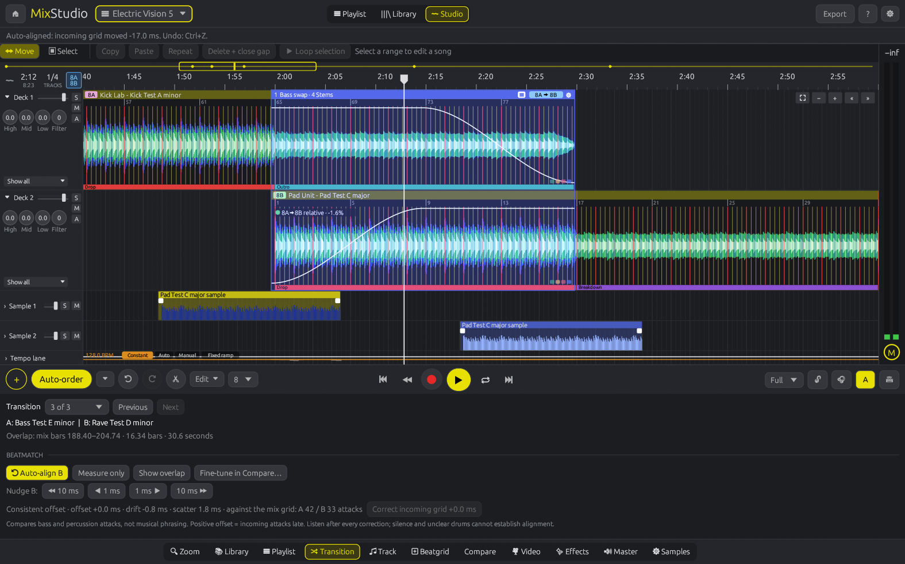
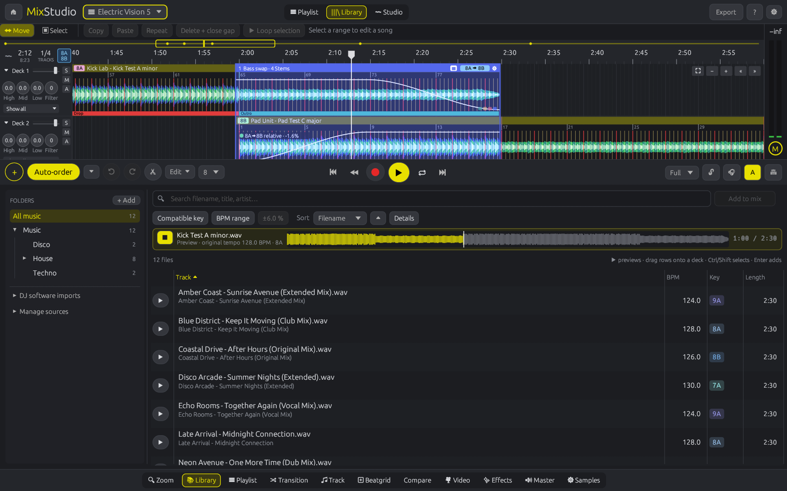
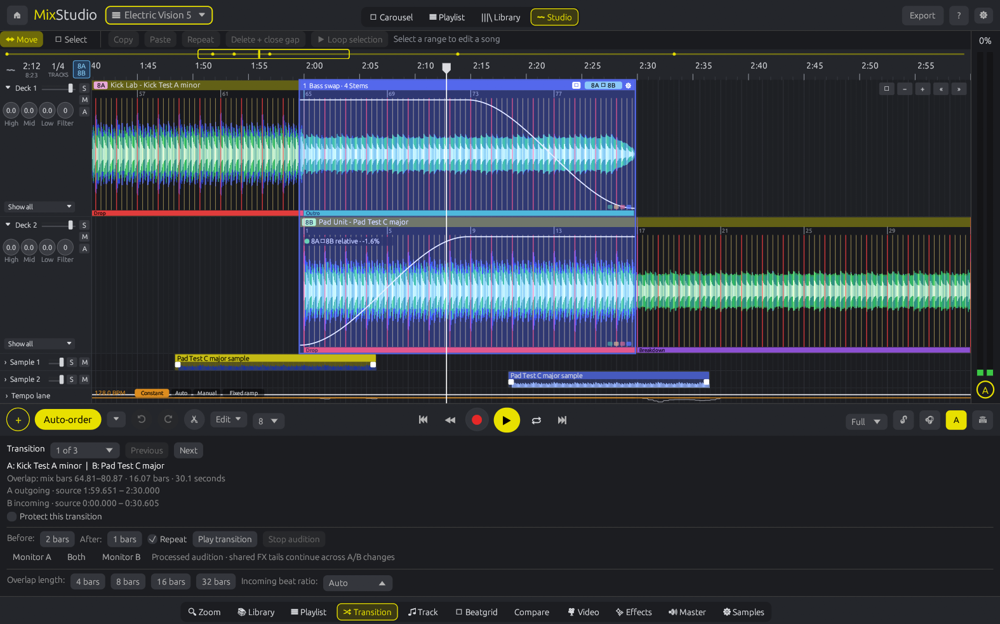

# MixStudio

**A DAW-style DJ mixing app written in Rust, where every song is its own clip on a timeline.**


> ⚠️ **Beta 0.30:** MixStudio works and is fun to use, but it's early. Expect rough edges, and keep your mixes backed up.



## New in 0.30

- **Beatgrids lock to the kicks.** Analysis now catches beat maps that drift off a steady track's kicks or sit on the offbeat hi-hats, so tracks at e.g. 125 and 126 BPM stay in sync after import. Beatgrid offers **Use current analysis** for clips saved with an older grid.
- **One-click Auto-align.** **Transition → Auto-align B** measures the overlap, corrects offset or tempo drift as one Undo step and measures again. Nudge B by ±1/±10 ms with `,` / `.`.
- **A roomier Library with preview.** Library mode gives the browser most of the window; press ▶ on any row to hear a file at its original tempo from the first drop.



Details: [release notes](docs/RELEASE-NOTES.md) · [changelog](CHANGELOG.md) · [0.30 verification](docs/BEATMATCH-LIBRARY-2026-10-26.md)

## Why

Live DJ software is built for performing: two decks, a crossfader, and one shot to get it right. Planning a mix is different. You want to see the whole set at once, move songs around, try a transition three ways and keep the best one. MixStudio treats a DJ mix like a DAW project. Tracks alternate between Deck 1 and Deck 2 on a timeline, the overlaps become transitions you can edit, and everything stays in sync with one mix tempo.

It's native, fast, and doesn't need an account. No sign-up, no license keys, no cloud. It's your music on your machine.

## Features

**Timeline and tempo**
- Songs alternate on Deck 1 and Deck 2 as clips with 3-band waveforms, beat/bar lines, phrase tags (Intro / Build / Drop / Breakdown / Outro), an overview strip and snapping (off / beat / half bar / bar).
- Every track is time-stretched through its beat map onto one mix tempo: **Constant**, **Auto** (each track at its own tempo, gliding through transitions), **Manual** tempo nodes or a **Fixed ramp**. Beat ratios (1:2, 2:3 …) lock half- and double-time tracks.
- Key lock with Signalsmith Stretch, or Vinyl (varispeed) and Beat slice per track. Playback and export share one engine.

**Analysis and beatgrids**
- Automatic BPM, Camelot key, downbeat, phrases and a dynamic beat map per track, cached and refreshed when the detector improves.
- Grid modes per clip (Fixed, Dynamic, Flex, Imported, Manual), ±1/±10 ms corrections, single-beat and beat-and-following edits, tap tempo, ×2/÷2 and two-anchor corrections in **Compare**.
- **Auto-align** and **Measure** check paired bass and percussion attacks in each overlap (or against the mix grid when the drums don't coincide) and only apply consistent evidence.

**Transitions and sound**
- Presets (Crossfade, Bass swap, High to low, Low to high, Echo out), overlap length, multi-point volume curves, protected transitions and processed A/B audition.
- AI stem separation (HT-Demucs via ONNX Runtime, GPU or CPU) with per-stem transition choices, stem mutes, stem volume curves and stem-to-sample copies.
- Per-deck 3-band EQ, filter, volume, mute/solo; automation lanes; effect blocks (reverb, echo, flanger, filter sweep, scratch) with an XY pad and presets; master gain, soft clipper and peak meters.
- Harmonic-match explanations and green/yellow/red compatibility badges for every transition; **Auto-order** sorts a playlist by key, tempo and energy.

**Editing and library**
- Non-destructive section editing (copy, repeat, delete + close gap, loop), split, trim, curved clip fades, sample lanes and Alt-drag sample copies. Every edit has one Undo step.
- Library of indexed music folders with folder browsing, search, key/BPM filters, background BPM/key analysis and preview; read-only import from Rekordbox, Traktor, Serato, Engine DJ and iTunes with path remapping and cue points.
- Autosave with recovery copies, atomic saves with a `.bak`, relinking of moved audio, and export to WAV 16/24-bit, FLAC 24-bit or MP3 320 kbps (with ffmpeg).

## Screenshots



| Transition editing | Beatgrid and assisted beatmatch |
|---|---|
|  |  |

| Automation and effects | Non-destructive section editing |
|---|---|
|  |  |


Captured on Linux with the app's generated demo music. More screenshots accompany the [release notes](docs/RELEASE-NOTES.md).

## Platforms

MixStudio is built with [egui/eframe](https://github.com/emilk/egui) and [cpal](https://github.com/RustAudio/cpal), so it's cross-platform by design: **Windows, Linux and macOS**. This beta is tested on Linux (CachyOS, KDE Plasma). Windows and macOS support has not been verified; there are no tested release packages for them yet.

On Linux, MixStudio prefers X11/XWayland when it's available, because winit doesn't support file drag and drop on native Wayland yet. Set `MIXSTUDIO_WAYLAND=1` to force native Wayland.

## Building

You need stable Rust (1.92 or newer), a C++14 compiler and libclang (for the Signalsmith Stretch bindings). Time-stretch dependency notices are in [TIME-STRETCH-LICENSES.md](docs/TIME-STRETCH-LICENSES.md).

```sh
# Linux: ALSA development headers, C++ compiler and libclang
#   Arch/CachyOS: sudo pacman -S alsa-lib base-devel clang
#   Debian/Ubuntu: sudo apt install libasound2-dev build-essential libclang-dev
git clone https://github.com/soulspin/MixStudio
cd MixStudio
cargo build --release
./target/release/mixstudio
```

### Stem separation (GPU or CPU)

Stem separation uses ONNX Runtime, which MixStudio loads at runtime, so the app builds and runs without it. Install it to enable stems:

```sh
# Arch / CachyOS with an NVIDIA GPU (pulls in cuda + cudnn):
sudo pacman -S onnxruntime-cuda
# CPU only:
sudo pacman -S onnxruntime-cpu
# Anywhere else: download onnxruntime from github.com/microsoft/onnxruntime/releases
# and point MixStudio at it:
export ORT_DYLIB_PATH=/path/to/libonnxruntime.so
```

The first time you separate a track, MixStudio downloads the model (166 MB, verified by SHA-256) to `~/.local/share/mixstudio/models`. Stems are cached in `~/.cache/mixstudio/stems` (about 30 MB per minute of audio). Set `MIXSTUDIO_CPU=1` to force CPU inference.

**Model and license:** `htdemucs_fp16weights.onnx` from [StemSplitio/htdemucs-onnx](https://huggingface.co/StemSplitio/htdemucs-onnx) (pinned revision). It's an ONNX export of HT-Demucs by Meta AI Research ([facebookresearch/demucs](https://github.com/facebookresearch/demucs)). Both the original weights/code and the export are **MIT-licensed**. The model isn't bundled with MixStudio.

Want to try it without your own music? `mixstudio --demo /tmp/ms-demo` generates four test tracks and builds a demo mix. Set `MIXSTUDIO_DEMO_TAB=sections` to open a prepared section-editing example. Other demo views: `transition`, `beatmatch`, `library`, `listen`, `playlist`, `wide`, `grid`, `compare`, `effects`, `master`, `recovery` (the default view is `track`). `MIXSTUDIO_SCREENSHOT=out.png` saves the window after a few seconds and exits.

Run `cargo test --locked` for the automated regression and headless interaction tests. `mixstudio --selftest /tmp/ms-test` runs analysis, beat alignment, stretching, rendering, imports and export checks; the model separation check skips if its model has not been downloaded. A local-audio integration check can be run separately:

```sh
MIXSTUDIO_SECTION_TEST_PROJECT=/path/to/mix.json \
  cargo test --locked render_saved_pair_after_section_edits -- --ignored --nocapture
```

The optional check reads local source files and writes an edited test mix and short render excerpts under the system temporary directory; it does not overwrite the source mix.

### Command line

`mixstudio --analyse <files>` prints BPM, downbeat and key. `mixstudio --align <a> <b>` mixes two tracks and measures kick alignment in the overlap. `mixstudio --selftest <dir>` runs the test suite.

## Usage

1. Open **Library**, add your music folders, press ▶ to preview, then double-click, press Enter or drag tracks onto the timeline. You can also click **+** or drop audio files on the window. Each new song goes on the next deck and overlaps the previous one by 16 bars.
2. Drag clips to adjust overlaps and click a blue transition bar. In **Transition**, use **Auto-align B**, then choose a preset, stems and curves and **Play transition** to listen.
3. Check grids in **Beatgrid** if a song still drifts, and set the mix tempo, key lock and output level in **Master**.
4. Choose **Select** above the timeline and drag a range on one song to repeat, copy, delete or loop it. Switch back to **Move** to drag clips.
5. Use **Auto-order** for a key/tempo-aware playlist, then export from **Master**.

| Shortcut | Action |
|---|---|
| Space | Play / pause (stops a preview or audition) |
| Ctrl + scroll / Scroll | Zoom around the pointer / move in time |
| Ctrl+Z / Ctrl+Shift+Z | Undo / redo |
| Ctrl+S / Ctrl+Shift+S | Save / save as |
| Ctrl+C / Ctrl+V / Ctrl+D | Copy section / insert at playhead in the same song / repeat after itself |
| Delete | Delete the selected section and close the gap; otherwise remove the selected track |
| Escape | Clear the section selection and its loop |
| Ctrl+E | Split the clip under the mouse / at the playhead |
| `,` / `.` | Nudge the incoming track 1 ms earlier / later (Shift: 10 ms) |
| Enter / Ctrl+A | Library: add the selection to the mix / select every visible file |
| Z | Zoom the decks vertically |
| Alt + drag | Duplicate a sample / move a clip's beatgrid |
| Shift + click on a beat line | Set the downbeat |
| Double-click a knob / fader | Reset |

## Known limitations

- Analysis is tuned for 4/4 dance music. Half/double tempo and which kick is bar 1 can still be wrong: listen, and use ×2 / ÷2, tap tempo or **Set downbeat**. Some drum & bass files cannot be analysed.
- **Dynamic** is the safe default grid. **Flex** is experimental and can produce bad timing on some tracks.
- Long exports hold the whole mix in memory (about 2.2 GB per hour at 44.1 kHz), and decoded sources stay in memory (about 100 MB per 6-minute track; stems add about 30 MB per minute).
- Stem separation on the CPU runs at about 1–2× real time on 8 cores; a GPU is much faster.
- The section clipboard works within the same source song.
- Projects store source paths and edits, not the audio. Keep the original files available, or use **Locate missing audio…**.
- File dialogs use the XDG portal, then kdialog, then zenity; `mixstudio --dialog-check` lists what works. You can also paste a folder path in the Library.
- Video export, headphone cue, MIDI controllers and VST hosting are not implemented.

## Roadmap

- Streaming export for long mixes, region export, CUE sheets and split files
- Section clipboard across songs and more flexible trim/extend tools
- Better analysis confidence, half/double and bar-1 handling for difficult tracks
- Library folder watching and set building across a whole library
- Headphone cue and MIDI controllers
- Video export, DJ-library export and VST effects

## Not affiliated

MixStudio is inspired by the timeline approach of DJ.Studio, but it's an independent project written from scratch. It isn't affiliated with, endorsed by, or connected to DJ.Studio, and it contains no code or assets from it.

## License

[MIT](LICENSE) © 2026 soulspin
