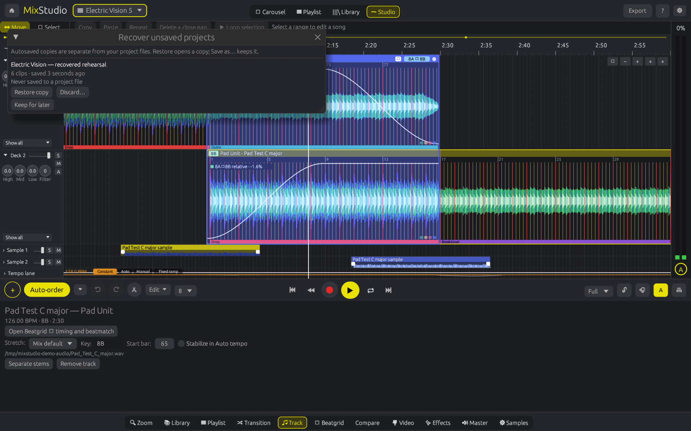
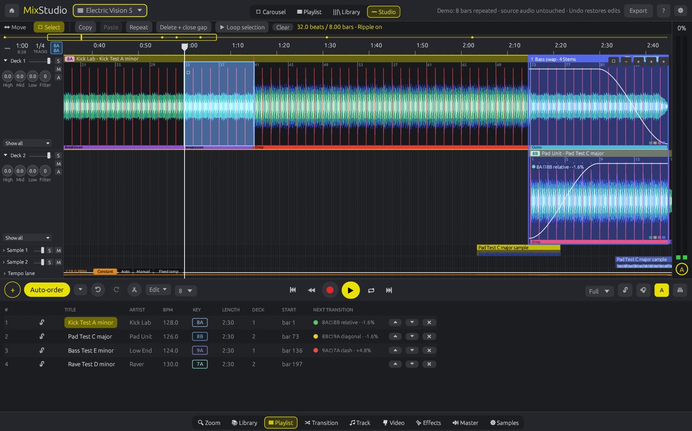
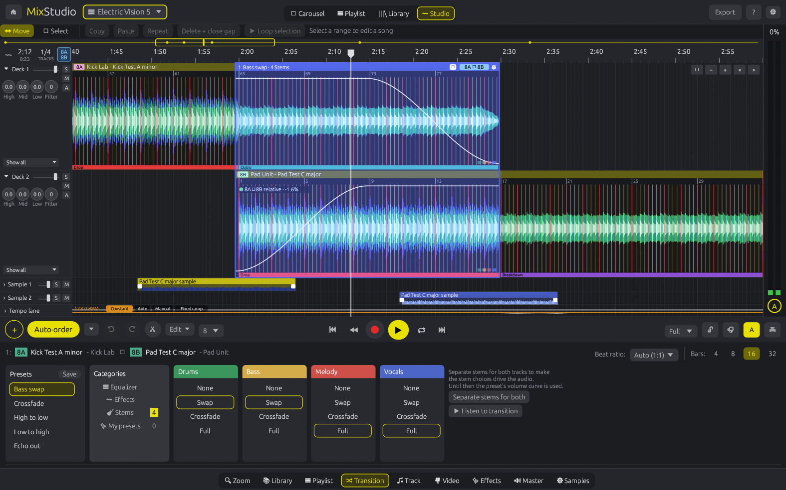
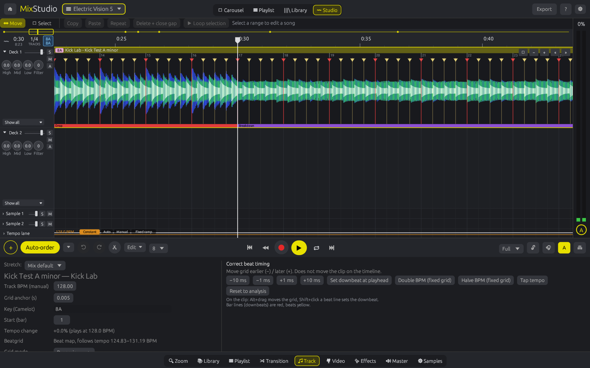
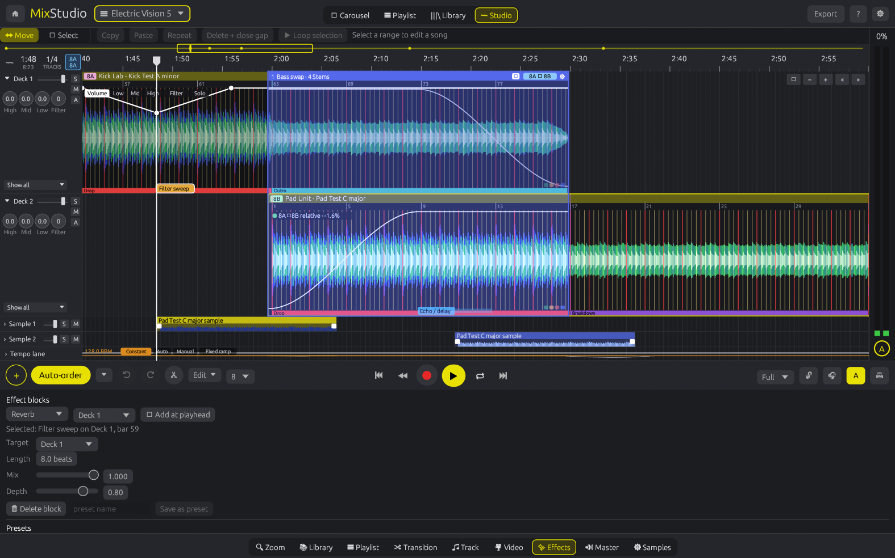
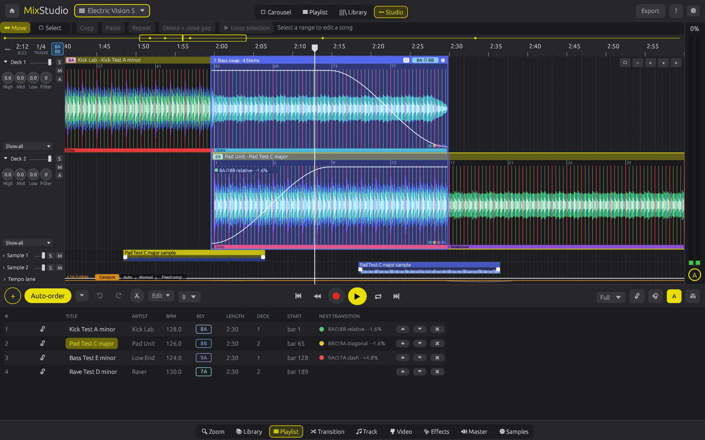
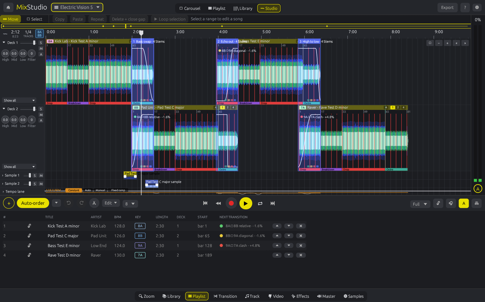

# MixStudio

**A DAW-style DJ mixing app written in Rust, where every song is its own clip on a timeline.**


> ⚠️ **Beta 0.22:** MixStudio works and is fun to use, but it's early. Expect rough edges, and keep your mixes backed up.



## New in 0.22

Beat analysis now rejects unsupported grids from stationary noise, isolated attacks with noise and sustained carrier tones. Gain-safe onset calculations preserve very quiet rhythmic recordings. Beatgrid shows an advisory when source evidence is insufficient or sparse. The [real-file test report](docs/BEAT-ANALYSIS-2026-10-16.md) records the corpus, measured changes and limits; these are not annotated musical accuracy scores.

Analysis cache version 11 refreshes derived results while retaining library tags and saved project grids. For an existing uncut source clip, use **Beatgrid → Reset to analysis** to adopt the new result; review it before section editing. Musical downbeats and half/double tempo still require listening and manual judgement.

## New in 0.21.2

Key lock now uses Signalsmith Stretch for cleaner vocals and polyphonic music during tempo changes. A buffered audio worker prepares playback ahead of the device callback; transport changes discard stale queued audio and the playhead follows consumed samples. See the [playback verification record](docs/PLAYBACK-2026-10-16.md).

## New in 0.21

This maintenance release addresses the prioritised renderer, editing and storage findings in the [application audit](docs/AUDIT-2026-10-16.md). See the [fixes and verification record](docs/MAINTENANCE-2026-10-16.md) for scope and remaining limits.

- **Playback:** remove the hidden 64-track key-lock and 16-effect limits, prepare DSP state outside the audio callback, retain unchanged effect history, and clear deleted/replaced effects safely. Seek resets filters and transport history.
- **Timing:** accurate tempo integration and loop boundaries, including tempo-floor crossings; identical rendered output across tested callback partitions. Tiny loops reanchor stretched audio. Effect starts/releases follow sample timing.
- **Editing:** retain full transition envelopes and source-cut smoothing after splitting, keep logical fragments together when changing transition position/length, lanes or ratios, and map phrases through the source grid and arranged occurrences. Layout remains stable on later frames.
- **File safety:** validate projects/recovery before activation or replacement, reject damaged sources where integrity can be checked, retain library metadata under unreadable subfolders, verify cached model hashes, preserve complete FX export tails, and isolate MP3 scratch files.

Compare dry audition includes every split fragment. Automatic beatmatch measurement/correction and two-anchor correction require unsplit clips; correct source grids before splitting. Existing split projects saved before this release lack logical fragment identity and are not automatically regrouped. A layout that oscillates between automatic half/double ratios keeps only the conflicting ratios explicit; Undo restores the previous layout.

## New in 0.20

- **More precise beat/BPM analysis:** fit steady tempo from supported sample-level attacks, preserve fractional BPM, interpolate missing kicks between supported attacks, and retain rhythm in side-dominant stereo without letting a sustained stereo pad hide centred kicks. Sparse attacks cannot qualify as a precise steady fit. Dynamic remains the default; deliberate ramps keep variable timing.
- **Existing libraries refresh:** detector version 10 invalidates old derived library BPM/key values while retaining tags. Cancelled analysis jobs cannot overwrite a newer scan.
- **Editing and source safety:** fix duplicate automation points and drag crashes, preserve explicit beat ratios when splitting, resolve Auto-tempo reorder against the requested order, handle Unicode keys safely, and keep dropped audio in unique persistent source paths.

Existing project grids and manual edits stay saved as they were. Reopen a project to load the new analysis, then use **Beatgrid → Reset to analysis** on an uncut source clip to adopt it. Correct the grid before making section edits. A displayed decimal is precision of representation, not a confidence guarantee.

Read the [full audit and prioritised open issues](docs/AUDIT-2026-10-16.md). The controlled test results are not a guarantee of perfect beat counts or musical downbeats on arbitrary recordings. The renderer timing, long-set key-lock and split-transition findings were subsequently addressed in 0.21; analysis confidence and broader music validation remain ongoing work.

## New in 0.19

- **Autosave and recovery:** check for changes once a second and keep a separate recovery snapshot approximately every 15 seconds while editing. Disk writes run on a background worker. Startup offers recoverable copies; **Restore copy** opens one without overwriting the original and requires **Save as…**.
- **Safer manual saves:** write a sibling temporary file, sync it, then replace the project. Keep the previous saved version beside it as `<project>.bak`. Failed writes preserve the previous file.
- **Protected project changes and normal close:** before New/Open replaces unsaved work, wait for a confirmed recovery write. Normal close also waits for confirmation; failure leaves the current project/app open. Old file dialogs, analysis results and edit drags cannot mutate the next document.
- **Relink moved audio:** use the project menu's **Locate missing audio…**, choose the same recording, review it and confirm. Update every split/arranged occurrence while keeping timing, beatgrids, sections, cues and phrase edits. Replacements shorter than source material used by the project are rejected; relinking has one Undo step.

Use the project-name menu for **Recover unsaved projects…**, **Locate missing audio…** and recovery status/errors. **Ctrl+S** saves and **Ctrl+Shift+S** opens Save as. A `*` beside the project name indicates unsaved changes (updated on the next one-second check).

Recovery files live in the app's configuration folder under `recovery` (`~/.config/mixstudio/recovery` on Linux). Keep them for later or explicitly discard an individual copy. Successful manual saving removes the active recovery and any copy restored into that document. To use a manual `.bak` backup, copy it to a `.json` filename and open that copy. Recovery snapshots are limited to 64 MiB; oversized or invalid snapshots fail visibly rather than replace a usable copy. Forced termination can lose changes made since the latest completed autosave.

## New in 0.18

- **Richer rhythm evidence:** combine bass attacks with broadband percussion onsets. Sparse, sustained or conflicting evidence stays uncertain. The comparison view marks weak sampled beats in yellow and supported pairs in green/cyan; unmarked beats have not been measured.
- **Compare view:** outgoing and incoming source waveforms share a mix-beat axis, with 2–32 beat zoom, navigation, separate **Listen A / B / both** buttons and a preview metronome. Dry audition bypasses transition curves, EQ, FX and stem automation and stops at the visible range's end. It restores the exact suspended loop and stays out of project/export data.
- **Two manual anchors:** assign two incoming source attacks to known mix beats, inspect the proposed BPM and hear/see the proposed grid before applying it. One Undo restores the old grid. The correction fits phase and a uniform tempo error while preserving the existing grid's local shape.

### Correct an overlap with two anchors

1. Open **Compare** (or **Beatgrid → Compare waveforms + anchors**) and select the transition. **Measure overlap** adds evidence markers; uncertain evidence does not prevent manual inspection.
2. Choose **Set A**, set its **Target mix beat**, then click the corresponding attack in the yellow incoming waveform. Beat numbers in this view start at 1. Fine-adjust the source time below the waveforms if needed.
3. Navigate later in the overlap, choose **Set B**, and assign a second clear attack to its target beat. Separate A and B by at least four beats; a longer interval makes drift easier to judge.
4. Toggle **Preview proposed grid**, listen to A/B/both with the metronome, then choose **Apply both anchors** when satisfied. Until Apply, saved projects and exports retain the original grid.

Anchors correct the incoming source clip and currently require unlocked editing, an uncut clip and a 1:1 beat ratio. They do not infer musical phrasing or remove arbitrary local timing errors. Correct the source grid before arranging sections; use single/following-beat edits for remaining local errors.

## New in 0.17

- **Dedicated Beatgrid tab:** source analysis, active grid BPM, mix BPM and beat ratio shown together. Whole-grid, single-beat and following-beat modes stay visible, with ±1/±10 ms correction, previous/next beat and zoom to target.
- **Assisted beatmatch:** choose a transition and **Measure overlap**. A background bass-attack check reports signed offset, drift, scatter and usable beat count. Consistent evidence enables an explicit incoming-grid correction with one Undo; drifting or uncertain evidence stays advisory.
- **Safer edits:** fractional grid anchors preserve neighbouring beat positions during single-beat edits, stale measurements cannot apply after timing changes, and arranged sections are protected from grid changes.
- **Clearer Track tab:** reachable clip properties and stem controls; timing tools live in Beatgrid. The playback buffer fix from 0.16.1 is retained.

The check compares bass attacks, not musical phrasing. Silence, sustained bass and unclear drums can leave too little evidence; listen after every correction. Single/following editing and overlap measurements currently require a 1:1 beat ratio. Correct the source grid before arranging sections.

## New in 0.16

- **Arrange sections inside a song:** select a beat- or bar-snapped range, repeat it, copy/paste it at the playhead, or delete it and close the gap.
- **Ripple editing:** later songs keep their transition overlaps when a song becomes longer or shorter. Later samples, effect blocks and manual tempo points move with the edit.
- **Audition the selection:** loop the marked section, then return to normal clip movement with **Move**. Each section edit has one Undo step.
- **Timing fixes:** fine grid offsets stay precise, edited sections keep their original source beatgrid, and splice fades/reset handling work in the shared playback/export renderer. **Dynamic** stays the default; experimental **Flex** is selected manually.

The clipboard in this first version rearranges sections **within the same source song**. It does not copy audio between different songs. Original audio files are never rewritten.


## Why

Live DJ software is built for performing: two decks, a crossfader, and one shot to get it right. Planning a mix is different. You want to see the whole set at once, move songs around, try a transition three ways and keep the best one. MixStudio treats a DJ mix like a DAW project. Tracks alternate between Deck 1 and Deck 2 on a timeline, the overlaps become transitions you can edit, and everything stays in sync with one mix tempo.

It's native, fast, and doesn't need an account. No sign-up, no license keys, no cloud. It's your music on your machine.

## Features (Beta 0.19)

- **Timeline decks:** songs alternate on Deck 1 and Deck 2 as coloured clips with 3-band waveforms (low/mid/high), beat and bar lines, bar numbers and heuristic phrase tags (Intro / Build / Drop / Breakdown / Outro). There's an overview strip, a time ruler, zoom (Ctrl+scroll), scrolling, a playhead, click-to-seek, and clip dragging with snapping (off / beat / half bar / bar).
- **Automatic analysis:** global BPM (tempogram + full-track comb + beat regression, about 0.02 BPM), musical key (chromagram plus Krumhansl profiles) shown as **Camelot** codes, and bar 1. Results and waveforms are cached and re-analysed automatically when the analysis improves.
- **Dynamic beatgrids:** every beat is tracked (dynamic-programming beat tracking, refined to the kick attack on a ripple-free low-band envelope and smoothed over 16 beats, so soft intro kicks and clicky main kicks land on the same grid), so tracks that drift in tempo (live-played, older or AI-generated material) still stay locked. The Beatgrid tab shows the analysis BPM, active grid and mix tempo. Projects saved before 0.3 load with the old fixed grid.
- **Beat-locked time-stretch:** every track plays at the mix tempo through its beat map, so the stretch ratio changes continuously and each beat lands on a mix beat (kicks within a few ms in the self-tests, even against a drifting track). Key lock (on by default) uses a built-in WSOLA stretcher that keeps the pitch; grains containing a kick or snare attack are placed exactly on the beat map, so attacks don't shift when a track is sped up or slowed down. Switch it off for classic varispeed. Playback and export share the same engine.
- **Editable beatgrid:** nudge ±1/±10 ms, Alt+drag the grid on a clip, set the downbeat (Shift+click a beat line or "Set downbeat at target"). These work on beat maps too. BPM ×2 / ÷2, **tap tempo** (a hand-set BPM switches the track to a fixed grid), and reset to analysis.
- **Beatgrid editor:** zoom in until beat markers (▼) appear on the clips. Use the persistent **Beatgrid** mode controls (or hover a marker for the popup): **Adjust full grid** (drag shifts the whole beat map), **Beat + following** (beats up to one bar to the left stay anchored and the following beats stretch; the tempo change is shown in %), or **Single beat**. Right-click a marker for *Set downbeat here* / *Set first beat here*. Fixed grids are turned into an editable beat map on the first edit, playback and export follow every edit immediately, and every edit can be undone. Correct the source beatgrid before arranging sections; grid changes are protected after section edits.
- **Section editing:** choose **Select** above the timeline and drag a range on one waveform. The existing snap setting chooses beats, half bars or bars. **Ctrl+C / Ctrl+V** copies and inserts within the same source song at the playhead; **Ctrl+D** repeats directly after the selection; **Delete + close gap** shortens the song. Following songs and their transitions move together, as do later samples, effect blocks and manual tempo nodes. **Loop selection** auditions the range. Original audio stays untouched; edits are saved in the mix JSON and each command has one Undo step. **Move** restores normal clip dragging. Section edges have short splice fades, and continuous source ranges merge automatically.
- **Timeline editing:** **Ctrl+E** splits the clip under the mouse (or at the playhead) into two clips that keep their source offsets. Drag a clip's left/right edge to trim or extend it, and drag a track's end onto the next clip to close a gap. Drag a transition's blue bar to move the incoming track. Drag a track down into a sample lane (or a sample up onto the decks). **Alt+drag** a sample to duplicate it, and drag the white squares on a sample to set its fade-in/out. Moves and trims snap magnetically to the playhead, clip edges and transition boundaries (yellow snap line), otherwise to the grid.
- **AI stem separation:** one click, or automatically for new tracks, splits a song into **drums, bass, melody and vocals** with [HT-Demucs](https://github.com/facebookresearch/demucs). It runs in the background through ONNX Runtime, on your **NVIDIA GPU via CUDA** when available, otherwise on the CPU. Stems are cached on disk, so each track is separated only once.
- **Per-stem transitions:** when both tracks have stems, the overlap shows four real stem lanes, and the Drums / Bass / Melody / Vocals choices (**None / Swap / Crossfade / Full**) drive the audio in playback and export. Swap the bass at the drop, keep the incoming vocals out, or let the drums ride. Without stems, the preset's volume curve is used.
- **Stem editing per track:** the **1 / 2 / 4** buttons in a clip's title bar switch between the full waveform, instrumental / vocals, and drums / bass / melody / vocals lanes. **Ctrl+drag** on a lane selects a range; right-click it to **Mute selection** (shown hatched), **Unmute selection**, or **Copy to sample lane**, which renders that stem range to a real audio clip (saved in `~/.cache/mixstudio/clips`) placed in sync on a sample lane. Mutes apply in playback and export, with or without key lock. If the stem model isn't downloaded yet, MixStudio offers to download it. ⚙ → *Transition stem colours* switches stems inside transitions between normal, dimmed and inverted colours.
- **Automation:** the **A** button in a clip's title bar shows multi-point automation lanes for **volume, low / mid / high EQ and filter** over the waveform. Pick a parameter (or **Solo** it), click to add a point, drag to move, right-click to delete. Points move with the clip. **Z** zooms the decks vertically. The Transition tab has its own multi-point volume curves for the outgoing and incoming track.
- **Effect blocks:** in the **Effects** tab, add **Reverb, Echo / delay, Flanger** or **Filter sweep** blocks to a deck, a sample lane or the master. They show as coloured strips on the timeline (drag to move, drag an edge to resize); reverb and echo ring out past the block end (tail). Parameters: mix, decay/feedback, depth, time. The **XY pad** auditions an effect live on the master while the mix plays; release and **Commit to a block** to keep it. Save any block as a **preset** (`~/.config/mixstudio/fx-presets.json`). Automation and effects apply in playback and export.
- **Tempo lane:** choose **Constant** (the mix tempo), **Auto** (every track at its own tempo, gliding through each transition), **Manual** (draw tempo nodes in the tempo lane: click to add, drag, right-click to delete) or **Fixed ramp** (start → end BPM across the mix, set in the Master tab). The engine follows the continuous tempo curve in playback and export.
- **Stretch mode per track** (Track tab): **Key lock** (WSOLA, keeps the pitch), **Vinyl** (varispeed, pitch follows tempo) or **Beat slice** (each beat plays at its original speed from the beat start), or the mix default.
- **Export formats** (Master tab): **WAV 16-bit, WAV 24-bit, FLAC 24-bit** (built-in, pure Rust) and **MP3 320 kbps** (through ffmpeg when it's installed).
- **Transitions:** overlaps become transition regions with presets that act on the audio: **Crossfade**, **Bass swap**, **High to low**, **Low to high** (filter sweeps) and **Echo out**. You can set the overlap length (4/8/16/32 bars), and the volume curves are drawn on the clips.
- **Mixer:** 3-band EQ (High/Mid/Low), filter (LP ↔ HP), volume, solo and mute per deck, plus level meters and a master meter.
- **Auto-order:** one click reorders the playlist for smooth transitions. Every pair of tracks is scored on Camelot key (same key, ±1, relative A/B, with energy-boost moves +2 / +7 weighted lower) and tempo (including half/double time). An optional energy curve (build up, peak in the middle, or flat) is also scored. A greedy start plus simulated annealing and 2-opt finds the order, taking about 20 ms for 100 tracks. Choose *Balanced*, *Harmonic first* or *Tempo first* in the ⏷ menu next to the button. Keep the first track in place, or lock any track with 🔒 in the playlist. The layout and beat-matched transitions are rebuilt, and Undo restores the old order.
- **Compatibility indicators:** every transition shows a green / yellow / red badge with the key move and tempo change (e.g. `8A→9A ±1 · +1.6%`), on the timeline and in the playlist's *Next transition* column.
- **Library:** add your music folders once (📁 *Add folder*). They're scanned recursively in the background (mp3, wav, flac, ogg, m4a/aac, aiff), and title, artist, album, genre and duration are read from the tags. The folder list is saved in `~/.config/mixstudio/library.json` and rescanned at every start; the index is incremental (path, size and modification time), so only new or changed files are read and removed files disappear. BPM and key are analysed in the background with limited concurrency (shared with the normal analysis cache) and a progress bar. The table is sortable (Title, Artist, BPM, Key, Duration, Genre, Folder), has a search box and **key-compatible** / **BPM ±%** filters relative to the selected (or current) track, and stays fast with 10 000+ files (virtualized rows). Double-click, *Add to mix*, or drag the selection onto the timeline; Ctrl/Shift for multi-select. Unplugged or failing drives show as *not available* / *not responding*; every disk access has a timeout, so a dying disk can't hang the scan, and their tracks stay in the index until the drive is back.
- **Sample lanes:** drop extra audio on Sample 1/2. It's synced to the mix tempo.
- **Metronome:** a click on mix beats, accented on the downbeat, with its own volume. It's never exported.
- **Undo/redo**, **save/load mixes as JSON**, **export** of the whole mix (WAV, FLAC, MP3), and **drag and drop** of audio files (mp3, wav, flac, ogg, m4a).

## Screenshots



Captured on Linux using the app's generated demo music. Beatgrid shows 0.21, Recovery 0.19, Compare 0.18, Track 0.17, and the other views 0.16.

| Transition editing | Track properties |
|---|---|
|  |  |

| Beatgrid and assisted beatmatch | Automation and effects |
|---|---|
|  |  |





## Roadmap

- Export a selected region, CUE sheets and split files
- Section clipboard across songs, plus more flexible arrangement trim/extend tools
- Better analysis confidence and correction workflows for difficult tracks
- Per-stem automation and higher-quality time-stretching
- Library folder watching and set creation across a whole library
- Headphone cue / pre-listen and MIDI controllers
- Video export, DJ-library export and VST effects
- Local lyric transcription; requires a separate verified model/runtime pipeline

## Platforms

MixStudio is built with [egui/eframe](https://github.com/emilk/egui) and [cpal](https://github.com/RustAudio/cpal), so it's cross-platform by design: **Windows, Linux and macOS**. This beta is tested on Linux (CachyOS, KDE Plasma). Windows and macOS support has not been verified; there are no tested release packages for them yet.

On Linux, MixStudio prefers X11/XWayland when it's available, because winit doesn't support file drag and drop on native Wayland yet. Set `MIXSTUDIO_WAYLAND=1` to force native Wayland.

## Building

You need stable Rust (1.92 or newer), a C++14 compiler and libclang (for the Signalsmith Stretch bindings). Time-stretch dependency notices are in [TIME-STRETCH-LICENSES.md](docs/TIME-STRETCH-LICENSES.md).

```sh
# Linux: ALSA development headers, C++ compiler and libclang
#   Arch/CachyOS: sudo pacman -S alsa-lib base-devel clang
#   Debian/Ubuntu: sudo apt install libasound2-dev build-essential libclang-dev
git clone https://github.com/soulspin/MixStudio
cd MixStudio
cargo build --release
./target/release/mixstudio
```

### Stem separation (GPU or CPU)

Stem separation uses ONNX Runtime, which MixStudio loads at runtime, so the app builds and runs without it. Install it to enable stems:

```sh
# Arch / CachyOS with an NVIDIA GPU (pulls in cuda + cudnn):
sudo pacman -S onnxruntime-cuda
# CPU only:
sudo pacman -S onnxruntime-cpu
# Anywhere else: download onnxruntime from github.com/microsoft/onnxruntime/releases
# and point MixStudio at it:
export ORT_DYLIB_PATH=/path/to/libonnxruntime.so
```

The first time you separate a track, MixStudio downloads the model (166 MB, verified by SHA-256) to `~/.local/share/mixstudio/models`. Stems are cached in `~/.cache/mixstudio/stems` (about 30 MB per minute of audio). Set `MIXSTUDIO_CPU=1` to force CPU inference.

**Model and license:** `htdemucs_fp16weights.onnx` from [StemSplitio/htdemucs-onnx](https://huggingface.co/StemSplitio/htdemucs-onnx) (pinned revision). It's an ONNX export of HT-Demucs by Meta AI Research ([facebookresearch/demucs](https://github.com/facebookresearch/demucs)). Both the original weights/code and the export are **MIT-licensed**. The model isn't bundled with MixStudio.

Want to try it without your own music? `mixstudio --demo /tmp/ms-demo` generates four test tracks and builds a demo mix. Set `MIXSTUDIO_DEMO_TAB=sections` to open a prepared section-editing example. Other demo views: `transition`, `playlist`, `wide`, `grid`, `effects`, `autoorder` (the default view is `track`).

Run `cargo test --locked` for the automated regression and headless interaction tests. `mixstudio --selftest /tmp/ms-test` runs analysis, beat alignment, stretching, rendering, imports and export checks; the model separation check skips if its model has not been downloaded. A local-audio integration check can be run separately:

```sh
MIXSTUDIO_SECTION_TEST_PROJECT=/path/to/mix.json \
  cargo test --locked render_saved_pair_after_section_edits -- --ignored --nocapture
```

The optional check reads local source files and writes an edited test mix and short render excerpts under the system temporary directory; it does not overwrite the source mix.

### Command line

`mixstudio --analyse <files>` prints BPM, downbeat and key. `mixstudio --align <a> <b>` mixes two tracks and measures kick alignment in the overlap. `mixstudio --selftest <dir>` runs the test suite.

## Usage

1. Open the **Library** tab, add your music folders, and double-click or drag tracks onto the timeline. Or click **+** (Add tracks) or drop audio files on the window. Each new song goes on the next deck and overlaps the previous one by 16 bars.
2. Drag clips to adjust overlaps, and click a blue transition bar to choose a preset in the **Transition** tab.
3. Fix any beatgrid in the **Track** tab, and set the mix tempo and key lock in **Master**.
4. Choose **Select** above the timeline and drag a range on one song. Use **Repeat**, **Copy / Paste**, **Delete + close gap** or **Loop selection**. Paste inserts at the playhead within that same source song. Switch to **Move** to drag clips normally.
5. Use **Auto-order** for a key/tempo-aware playlist, then choose an export format in **Master** and export the mix.

| Shortcut | Action |
|---|---|
| Space | Play / pause |
| Ctrl + scroll | Zoom around the pointer |
| Scroll | Move in time |
| Ctrl+Z / Ctrl+Shift+Z | Undo / redo |
| Ctrl+C / Ctrl+V | Copy selected section / insert at playhead within the same song |
| Ctrl+D | Repeat the selected section directly after itself |
| Delete | Delete the selected section and close the gap; otherwise remove the selected track in Move mode |
| Escape | Clear the section selection and its playback loop |
| Z | Zoom the decks vertically |
| Ctrl+E | Split the clip under the mouse / at the playhead |
| Alt + drag on a sample | Duplicate it |
| Alt + drag on a clip | Move the beatgrid |
| Shift + click on a beat line | Set the downbeat |
| Double-click a knob / fader | Reset |

## Known limitations

- Stem separation on the CPU is slower than real time on long tracks (about 1–2× real time on 8 cores). A GPU is much faster.
- Stems are held in memory as 16-bit audio (about 30 MB per minute per track).
- WSOLA is good, but not Rubber Band quality. Big tempo changes on pads and vocals can sound grainy.
- **Dynamic** is the safe default for gradual drift. **Flex** is experimental and can produce bad beat timing on some tracks; irregular source beat spacing can cause severe tempo changes in Auto mode. Use Dynamic if this happens.
- Section clipboard is currently limited to the same source song. An arranged clip's trim can reverse during one drag; to restore material removed by a committed trim, use Undo.
- Save files store source paths and edits, not the audio itself. Keep the original audio available.
- Analysis is tuned for 4/4 dance music. Some tracks are detected at half or double tempo (use ×2 / ÷2 or tap tempo).
- Section tags are a rough energy guess.
- File dialogs use the XDG desktop portal (KDE/GNOME), then kdialog, then zenity. If none works, the status line says why: type or paste a folder path in the Library tab, or drop a folder on the window. `MIXSTUDIO_DIALOG=kdialog` (or portal/zenity) forces one; `mixstudio --dialog-check` lists what is available.
- Carousel, video export, headphone cue and VST hosting are not implemented.
- Decoded audio is held in memory (about 100 MB per 6-minute track).

## Not affiliated

MixStudio is inspired by the timeline approach of DJ.Studio, but it's an independent project written from scratch. It isn't affiliated with, endorsed by, or connected to DJ.Studio, and it contains no code or assets from it.

## License

[MIT](LICENSE) © 2026 soulspin

### Scratch effect (v0.11)
Add a **Scratch** block in the effects grid on a deck or sample lane. It drives the turntable position under the block
(smooth varispeed, a falling line plays in reverse) and loops when the block is longer than the pattern.
Presets: Baby scratch, Downer, Transformer, Reverse, Chirp. **✎ Pattern editor…** opens the syntax editor:
`A`–`E` position targets within the beat (A = start, E = end), `.` next beat, `r` release (mute), `>` open, `-` hold;
with live graph, Easing, Preview, Save as preset and Delete. Applies in playback and export.

### Phrase detection (v0.12)
Analysis finds phrase boundaries on the 8/16/32-bar grid from energy, spectrum (3 bands) and novelty, and labels
them **Intro / Build / Drop / Breakdown / Outro** (heuristic). Coloured phrase strips and markers sit on every clip:
click a phrase to cycle its label, right-click to choose one or reset to the detection (edits are saved in the project).
Clips snap to other clips' phrase boundaries. Auto-order and *Overlap outros with intros* start the next track's
intro on the previous track's outro. (Analysis cache v9: stale cached analysis is regenerated.)

### Import from other DJ software (v0.13)
The Library tab has a sidebar with your MixStudio folders and **Other DJ software**: *Find libraries* looks in the
usual places (home, Documents, Music, mounted drives incl. Windows/macOS user folders), or *Browse…* / paste a file:
Rekordbox XML (File ▸ Export Collection in xml format), Traktor `collection.nml`, Serato `_Serato_/database V2`
(+ crates), Engine DJ `Engine Library/Database2/m.db`, iTunes / Music `Library.xml`. Playlists and folders appear as a
tree; the table shows the other app's BPM and key (e.g. *Key (Rekordbox)*) next to MixStudio's. Cue points
(Rekordbox, Traktor) become orange markers on the clip when the track is added to the mix. **Path remapping** rewrites
prefixes such as `C:\Users\Mike\Music` → `/mnt/windows/Users/Mike/Music`. Imports are strictly read-only (Engine's
database is read from a temporary copy). Not yet: Serato / Engine cue points (stored in file tags / compressed blobs).

### Big tempo jumps (v0.14)
Each transition has a **Beat ratio** (transition panel): *Auto*, 1:1, 1:2, 2:1, 2:3, 3:2. With 1:2 one beat of the
incoming track spans two mix beats, so a 70 BPM track locks onto a 140 BPM mix (kicks within a millisecond in the
selftest); 2:3 maps two track beats onto three mix beats. *Auto* (default) switches to half / double time only when it
is clearly closer to the tempo it joins, which also fixes Auto tempo gliding 140 → 70 BPM between such tracks.

### Beatgrids (v0.15)
- **Grid mode per clip** (Beatgrid tab): *Fixed* (straight grid at the average BPM), *Dynamic* (the analysed beat map),
  *Flex* (piecewise grid that follows tempo jumps and ramps, found by change-point detection on the tempo curve),
  *Imported* (Rekordbox/Traktor grid, when the track came from an import) and *Manual* (set automatically when you
  edit the grid). Split clips keep their own mode.
- **Stabilize tempo** (Track tab): in Auto tempo a stabilized clip plays flat at its average tempo. Typical use: split
  at the intro and outro, stabilize just those clips so they mix on a straight grid; boundaries stay seamless.
- **Tempo lane**: per clip the average BPM (orange) and the local tempo (grey); zoom in to see drift % labels.
- **Downbeats**: bar lines red, beats yellow, bars stay visible zoomed out; *Set downbeat* recolours them.

### Section editing and timing corrections (v0.16)
- Ordered source ranges keep repeated and deleted sections non-destructive; the waveform and audio renderer use the same arrangement mapping.
- Source automation follows copied/deleted ranges. Manual tempo interpolation outside the edit is preserved when later points ripple.
- Short splice fades and section-aware WSOLA pre-roll avoid carrying audio from the previous section across a cut. Beat Slice evaluates its source endpoints inside the current section.
- Selection clears when its song, grid or timeline placement changes, preventing actions on an outdated range. Edited trim gestures use the drag-start arrangement so dragging back restores material within the same gesture.
- Dynamic/Flex/Imported grid evaluation preserves fine fractional offsets. Returning to an analysed grid restores its compatible source BPM; Flex is never enabled automatically.

### Beatgrid controls and assisted alignment (v0.17)
The **Beatgrid** tab separates source-grid correction from clip placement. Fine corrections use source seconds; positive values move grid markers later in the source, making the corresponding audio play earlier against the mix grid. The selected target is the nearest visible clip beat to the playhead. **Beat + following** stretches from the marker one bar before the target.

**Measure overlap** compares paired bass attacks on a background thread. Positive offset means incoming attacks are late. The report distinguishes consistent offset, drift and inconsistent attacks. Only sufficiently supported constant offsets enable **Correct incoming grid**. The check rejects sparse attacks and limited coverage; it does not infer the musical downbeat or rewrite analysis. Changed timing or audio invalidates the result, and each applied correction has one Undo step.
