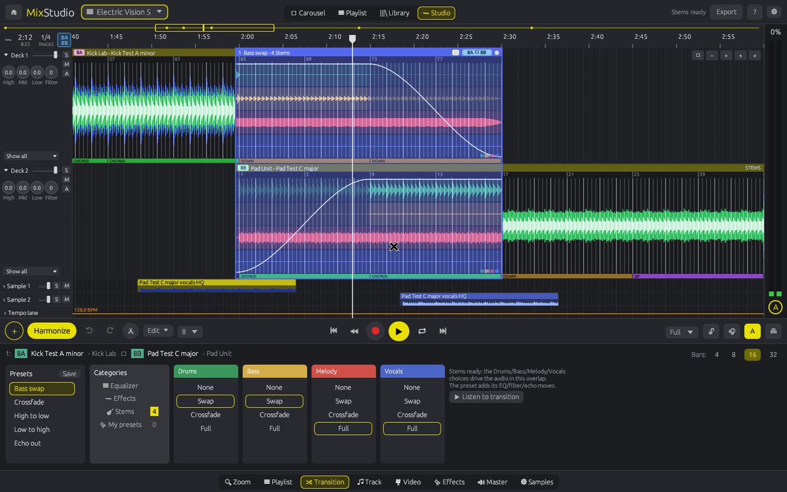
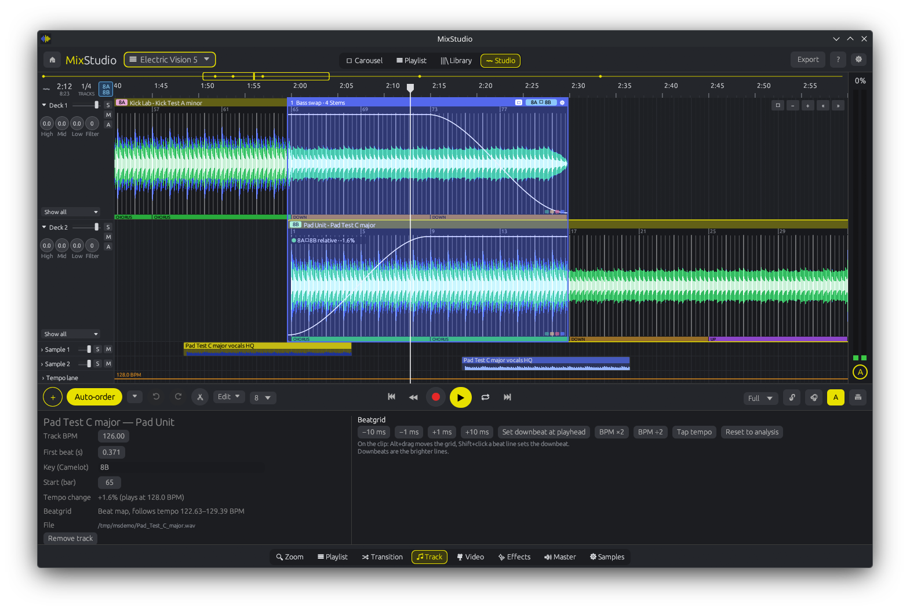

# MixStudio

**A DAW-style DJ mixing app written in Rust, where every song is its own clip on a timeline.**


> ⚠️ **Beta 0.10:** MixStudio works and is fun to use, but it's early. Expect rough edges, and keep your mixes backed up.


## Why

Live DJ software is built for performing: two decks, a crossfader, and one shot to get it right. Planning a mix is different. You want to see the whole set at once, move songs around, try a transition three ways and keep the best one. MixStudio treats a DJ mix like a DAW project. Tracks alternate between Deck 1 and Deck 2 on a timeline, the overlaps become transitions you can edit, and everything stays in sync with one mix tempo.

It's native, fast, and doesn't need an account. No sign-up, no license keys, no cloud. It's your music on your machine.

## Features (Beta 0.10)

- **Timeline decks:** songs alternate on Deck 1 and Deck 2 as coloured clips with 3-band waveforms (low/mid/high), beat and bar lines, bar numbers and rough section tags (DOWN / CHORUS / UP). There's an overview strip, a time ruler, zoom (Ctrl+scroll), scrolling, a playhead, click-to-seek, and clip dragging with snapping (off / beat / half bar / bar).
- **Automatic analysis:** global BPM (tempogram + full-track comb + beat regression, about 0.02 BPM), musical key (chromagram plus Krumhansl profiles) shown as **Camelot** codes, and bar 1. Results and waveforms are cached and re-analysed automatically when the analysis improves.
- **Dynamic beatgrids:** every beat is tracked (dynamic-programming beat tracking, refined to the kick attack on a ripple-free low-band envelope and smoothed over 16 beats, so soft intro kicks and clicky main kicks land on the same grid), so tracks that drift in tempo (live-played, older or AI-generated material) still stay locked. The Track tab shows the tempo range the beat map follows. Projects saved before 0.3 load with the old fixed grid.
- **Beat-locked time-stretch:** every track plays at the mix tempo through its beat map, so the stretch ratio changes continuously and each beat lands on a mix beat (kicks within a few ms in the self-tests, even against a drifting track). Key lock (on by default) uses a built-in WSOLA stretcher that keeps the pitch; grains containing a kick or snare attack are placed exactly on the beat map, so attacks don't shift when a track is sped up or slowed down. Switch it off for classic varispeed. Playback and export share the same engine.
- **Editable beatgrid:** nudge ±1/±10 ms, Alt+drag the grid on a clip, set the downbeat (Shift+click a beat line or "Set downbeat at playhead"). These work on beat maps too. BPM ×2 / ÷2, **tap tempo** (a hand-set BPM switches the track to a fixed grid), and reset to analysis.
- **Beatgrid editor:** zoom in until beat markers (▼) appear on the clips. Hover a marker for the mode popup: **Adjust full grid** (drag shifts the whole beat map), **Beat + following** (beats up to one bar to the left stay anchored and the following beats stretch; the tempo change is shown in %), or **Single beat**. Right-click a marker for *Set downbeat here* / *Set first beat here*. Fixed grids are turned into an editable beat map on the first edit, playback and export follow every edit immediately, and every edit can be undone.
- **Timeline editing:** **Ctrl+E** splits the clip under the mouse (or at the playhead) into two clips that keep their source offsets. Drag a clip's left/right edge to trim or extend it, and drag a track's end onto the next clip to close a gap. Drag a transition's blue bar to move the incoming track. Drag a track down into a sample lane (or a sample up onto the decks). **Alt+drag** a sample to duplicate it, and drag the white squares on a sample to set its fade-in/out. Moves and trims snap magnetically to the playhead, clip edges and transition boundaries (yellow snap line), otherwise to the grid.
- **AI stem separation:** one click, or automatically for new tracks, splits a song into **drums, bass, melody and vocals** with [HT-Demucs](https://github.com/facebookresearch/demucs). It runs in the background through ONNX Runtime, on your **NVIDIA GPU via CUDA** when available, otherwise on the CPU. Stems are cached on disk, so each track is separated only once.
- **Per-stem transitions:** when both tracks have stems, the overlap shows four real stem lanes, and the Drums / Bass / Melody / Vocals choices (**None / Swap / Crossfade / Full**) drive the audio in playback and export. Swap the bass at the drop, keep the incoming vocals out, or let the drums ride. Without stems, the preset's volume curve is used.
- **Stem editing per track:** the **1 / 2 / 4** buttons in a clip's title bar switch between the full waveform, instrumental / vocals, and drums / bass / melody / vocals lanes. **Ctrl+drag** on a lane selects a range; right-click it to **Mute selection** (shown hatched), **Unmute selection**, or **Copy to sample lane**, which renders that stem range to a real audio clip (saved in `~/.cache/mixstudio/clips`) placed in sync on a sample lane. Mutes apply in playback and export, with or without key lock. If the stem model isn't downloaded yet, MixStudio offers to download it. ⚙ → *Transition stem colours* switches stems inside transitions between normal, dimmed and inverted colours.
- **Automation:** the **A** button in a clip's title bar shows multi-point automation lanes for **volume, low / mid / high EQ and filter** over the waveform. Pick a parameter (or **Solo** it), click to add a point, drag to move, right-click to delete. Points move with the clip. **Z** zooms the decks vertically. The Transition tab has its own multi-point volume curves for the outgoing and incoming track.
- **Effect blocks:** in the **Effects** tab, add **Reverb, Echo / delay, Flanger** or **Filter sweep** blocks to a deck, a sample lane or the master. They show as coloured strips on the timeline (drag to move, drag an edge to resize); reverb and echo ring out past the block end (tail). Parameters: mix, decay/feedback, depth, time. The **XY pad** auditions an effect live on the master while the mix plays; release and **Commit to a block** to keep it. Save any block as a **preset** (`~/.config/mixstudio/fx-presets.json`). Automation and effects apply in playback and export.
- **Tempo lane:** choose **Constant** (the mix tempo), **Auto** (every track at its own tempo, gliding through each transition), **Manual** (draw tempo nodes in the tempo lane: click to add, drag, right-click to delete) or **Fixed ramp** (start → end BPM across the mix, set in the Master tab). The engine follows the continuous tempo curve in playback and export.
- **Stretch mode per track** (Track tab): **Key lock** (WSOLA, keeps the pitch), **Vinyl** (varispeed, pitch follows tempo) or **Beat slice** (each beat plays at its original speed from the beat start), or the mix default.
- **Export formats** (Master tab): **WAV 16-bit, WAV 24-bit, FLAC 24-bit** (built-in, pure Rust) and **MP3 320 kbps** (through ffmpeg when it's installed).
- **Transitions:** overlaps become transition regions with presets that act on the audio: **Crossfade**, **Bass swap**, **High to low**, **Low to high** (filter sweeps) and **Echo out**. You can set the overlap length (4/8/16/32 bars), and the volume curves are drawn on the clips.
- **Mixer:** 3-band EQ (High/Mid/Low), filter (LP ↔ HP), volume, solo and mute per deck, plus level meters and a master meter.
- **Auto-order:** one click reorders the playlist for smooth transitions. Every pair of tracks is scored on Camelot key (same key, ±1, relative A/B, with energy-boost moves +2 / +7 weighted lower) and tempo (including half/double time). An optional energy curve (build up, peak in the middle, or flat) is also scored. A greedy start plus simulated annealing and 2-opt finds the order, taking about 20 ms for 100 tracks. Choose *Balanced*, *Harmonic first* or *Tempo first* in the ⏷ menu next to the button. Keep the first track in place, or lock any track with 🔒 in the playlist. The layout and beat-matched transitions are rebuilt, and Undo restores the old order.
- **Compatibility indicators:** every transition shows a green / yellow / red badge with the key move and tempo change (e.g. `8A→9A ±1 · +1.6%`), on the timeline and in the playlist's *Next transition* column.
- **Library:** add your music folders once (📁 *Add folder*). They're scanned recursively in the background (mp3, wav, flac, ogg, m4a/aac, aiff), and title, artist, album, genre and duration are read from the tags. The folder list is saved in `~/.config/mixstudio/library.json` and rescanned at every start; the index is incremental (path, size and modification time), so only new or changed files are read and removed files disappear. BPM and key are analysed in the background with limited concurrency (shared with the normal analysis cache) and a progress bar. The table is sortable (Title, Artist, BPM, Key, Duration, Genre, Folder), has a search box and **key-compatible** / **BPM ±%** filters relative to the selected (or current) track, and stays fast with 10 000+ files (virtualized rows). Double-click, *Add to mix*, or drag the selection onto the timeline; Ctrl/Shift for multi-select. Unplugged or failing drives show as *not available* / *not responding*; every disk access has a timeout, so a dying disk can't hang the scan, and their tracks stay in the index until the drive is back.
- **Sample lanes:** drop extra audio on Sample 1/2. It's synced to the mix tempo.
- **Metronome:** a click on mix beats, accented on the downbeat, with its own volume. It's never exported.
- **Undo/redo**, **save/load mixes as JSON**, **export** of the whole mix (WAV, FLAC, MP3), and **drag and drop** of audio files (mp3, wav, flac, ogg, m4a).

| Transition tab | Track / Beatgrid tab | Playlist |
|---|---|---|
|  |  |  |






## Roadmap

- AI lyrics: Whisper transcription of the vocal stem as a lyric lane (planned for v0.15, postponed: it needs a ~150 MB+ model download and an encoder/decoder + tokenizer pipeline that could not be verified on the test machine yet)
- Per-stem automation curves and stem solo/mute on clips
- Higher-quality stem models (HT-Demucs fine-tuned bag, MDX-Net)
- Rubber Band-quality time-stretching
- Automix that picks transition presets per phrase pair (phrase-aware overlaps landed in v0.12)
- Auto-order across a whole library (build a set from a crate), with BPM-range and must-include constraints
- Tempo automation in the tempo lane
- Editing single beats in the beat map (warp markers) and non-4/4 meters
- MIDI controller support
- Headphone cue / pre-listen
- Library: watch folders for changes live (filesystem watcher); for now, rescan at start or with *Rescan now*
- Video export
- Rekordbox / Serato export (import landed in v0.13); Serato / Engine cue point import
- VST effects

## Platforms

MixStudio is built with [egui/eframe](https://github.com/emilk/egui) and [cpal](https://github.com/RustAudio/cpal), so it's cross-platform by design: **Windows, Linux and macOS**. The Alpha is tested on Linux (CachyOS, KDE Plasma). Windows and macOS builds are coming.

On Linux, MixStudio prefers X11/XWayland when it's available, because winit doesn't support file drag and drop on native Wayland yet. Set `MIXSTUDIO_WAYLAND=1` to force native Wayland.

## Building

You need stable Rust (1.92 or newer).

```sh
# Linux: ALSA development headers
#   Arch/CachyOS: sudo pacman -S alsa-lib
#   Debian/Ubuntu: sudo apt install libasound2-dev
git clone https://github.com/soulspin/MixStudio
cd MixStudio
cargo build --release
./target/release/mixstudio
```

### Stem separation (GPU or CPU)

Stem separation uses ONNX Runtime, which MixStudio loads at runtime, so the app builds and runs without it. Install it to enable stems:

```sh
# Arch / CachyOS with an NVIDIA GPU (pulls in cuda + cudnn):
sudo pacman -S onnxruntime-cuda
# CPU only:
sudo pacman -S onnxruntime-cpu
# Anywhere else: download onnxruntime from github.com/microsoft/onnxruntime/releases
# and point MixStudio at it:
export ORT_DYLIB_PATH=/path/to/libonnxruntime.so
```

The first time you separate a track, MixStudio downloads the model (166 MB, verified by SHA-256) to `~/.local/share/mixstudio/models`. Stems are cached in `~/.cache/mixstudio/stems` (about 30 MB per minute of audio). Set `MIXSTUDIO_CPU=1` to force CPU inference.

**Model and license:** `htdemucs_fp16weights.onnx` from [StemSplitio/htdemucs-onnx](https://huggingface.co/StemSplitio/htdemucs-onnx) (pinned revision). It's an ONNX export of HT-Demucs by Meta AI Research ([facebookresearch/demucs](https://github.com/facebookresearch/demucs)). Both the original weights/code and the export are **MIT-licensed**. The model isn't bundled with MixStudio.

Want to try it without your own music? `mixstudio --demo /tmp/ms-demo` generates four test tracks and builds a demo mix. `mixstudio --selftest /tmp/ms-test` runs the analysis, stretch and render self-tests.

### Command line

`mixstudio --analyse <files>` prints BPM, downbeat and key. `mixstudio --align <a> <b>` mixes two tracks and measures kick alignment in the overlap. `mixstudio --selftest <dir>` runs the test suite.

## Usage

1. Open the **Library** tab, add your music folders, and double-click or drag tracks onto the timeline. Or click **+** (Add tracks) or drop audio files on the window. Each new song goes on the next deck and overlaps the previous one by 16 bars.
2. Drag clips to adjust overlaps, and click a blue transition bar to choose a preset in the **Transition** tab.
3. Fix any beatgrid in the **Track** tab, and set the mix tempo and key lock in **Master**.
4. Press **Harmonize** for a key-friendly order, then **Export** to render a WAV.

| Shortcut | Action |
|---|---|
| Space | Play / pause |
| Ctrl + scroll | Zoom around the pointer |
| Scroll | Move in time |
| Ctrl+Z / Ctrl+Shift+Z | Undo / redo |
| Delete | Remove the selected track |
| Z | Zoom the decks vertically |
| Ctrl+E | Split the clip under the mouse / at the playhead |
| Alt + drag on a sample | Duplicate it |
| Alt + drag on a clip | Move the beatgrid |
| Shift + click on a beat line | Set the downbeat |
| Double-click a knob / fader | Reset |

## Known limitations

- Stem separation on the CPU is slower than real time on long tracks (about 1–2× real time on 8 cores). A GPU is much faster.
- Stems are held in memory as 16-bit audio (about 30 MB per minute per track).
- WSOLA is good, but not Rubber Band quality. Big tempo changes on pads and vocals can sound grainy.
- Beat maps follow gradual drift, not sudden tempo jumps or rubato.
- Analysis is tuned for 4/4 dance music. Some tracks are detected at half or double tempo (use ×2 / ÷2 or tap tempo).
- Section tags are a rough energy guess.
- File dialogs use the XDG desktop portal (KDE/GNOME), then kdialog, then zenity. If none works, the status line says why: type or paste a folder path in the Library tab, or drop a folder on the window. `MIXSTUDIO_DIALOG=kdialog` (or portal/zenity) forces one; `mixstudio --dialog-check` lists what is available.
- Carousel, Video, effects beyond EQ/filter/echo, and headphone cue aren't implemented yet.
- Decoded audio is held in memory (about 100 MB per 6-minute track).

## Not affiliated

MixStudio is inspired by the timeline approach of DJ.Studio, but it's an independent project written from scratch. It isn't affiliated with, endorsed by, or connected to DJ.Studio, and it contains no code or assets from it.

## License

[MIT](LICENSE) © 2026 soulspin

### Scratch effect (v0.11)
Add a **Scratch** block in the effects grid on a deck or sample lane. It drives the turntable position under the block
(smooth varispeed, a falling line plays in reverse) and loops when the block is longer than the pattern.
Presets: Baby scratch, Downer, Transformer, Reverse, Chirp. **✎ Pattern editor…** opens the syntax editor:
`A`–`E` position targets within the beat (A = start, E = end), `.` next beat, `r` release (mute), `>` open, `-` hold;
with live graph, Easing, Preview, Save as preset and Delete. Applies in playback and export.

### Phrase detection (v0.12)
Analysis finds phrase boundaries on the 8/16/32-bar grid from energy, spectrum (3 bands) and novelty, and labels
them **Intro / Build / Drop / Breakdown / Outro** (heuristic). Coloured phrase strips and markers sit on every clip:
click a phrase to cycle its label, right-click to choose one or reset to the detection (edits are saved in the project).
Clips snap to other clips' phrase boundaries. Auto-order and *Overlap outros with intros* start the next track's
intro on the previous track's outro. (Analysis cache v7: tracks are re-analysed once.)

### Import from other DJ software (v0.13)
The Library tab has a sidebar with your MixStudio folders and **Other DJ software**: *Find libraries* looks in the
usual places (home, Documents, Music, mounted drives incl. Windows/macOS user folders), or *Browse…* / paste a file:
Rekordbox XML (File ▸ Export Collection in xml format), Traktor `collection.nml`, Serato `_Serato_/database V2`
(+ crates), Engine DJ `Engine Library/Database2/m.db`, iTunes / Music `Library.xml`. Playlists and folders appear as a
tree; the table shows the other app's BPM and key (e.g. *Key (Rekordbox)*) next to MixStudio's. Cue points
(Rekordbox, Traktor) become orange markers on the clip when the track is added to the mix. **Path remapping** rewrites
prefixes such as `C:\Users\Mike\Music` → `/mnt/windows/Users/Mike/Music`. Imports are strictly read-only (Engine's
database is read from a temporary copy). Not yet: Serato / Engine cue points (stored in file tags / compressed blobs).

### Big tempo jumps (v0.14)
Each transition has a **Beat ratio** (transition panel): *Auto*, 1:1, 1:2, 2:1, 2:3, 3:2. With 1:2 one beat of the
incoming track spans two mix beats, so a 70 BPM track locks onto a 140 BPM mix (kicks within a millisecond in the
selftest); 2:3 maps two track beats onto three mix beats. *Auto* (default) switches to half / double time only when it
is clearly closer to the tempo it joins, which also fixes Auto tempo gliding 140 → 70 BPM between such tracks.

### Beatgrids (v0.15)
- **Grid mode per clip** (Track tab): *Fixed* (straight grid at the average BPM), *Dynamic* (the analysed beat map),
  *Flex* (piecewise grid that follows tempo jumps and ramps, found by change-point detection on the tempo curve),
  *Imported* (Rekordbox/Traktor grid, when the track came from an import) and *Manual* (set automatically when you
  edit the grid). Split clips keep their own mode.
- **Stabilize tempo** (Track tab): in Auto tempo a stabilized clip plays flat at its average tempo. Typical use: split
  at the intro and outro, stabilize just those clips so they mix on a straight grid; boundaries stay seamless.
- **Tempo lane**: per clip the average BPM (orange) and the local tempo (grey); zoom in to see drift % labels.
- **Downbeats**: bar lines red, beats yellow, bars stay visible zoomed out; *Set downbeat* recolours them.
