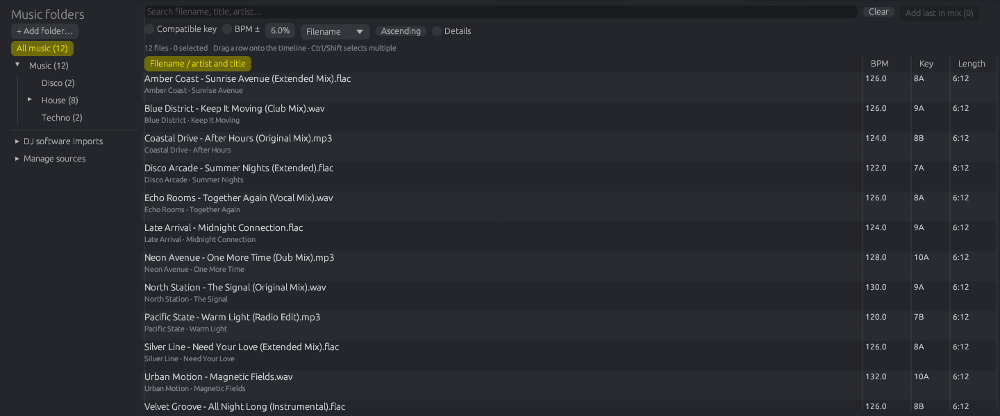
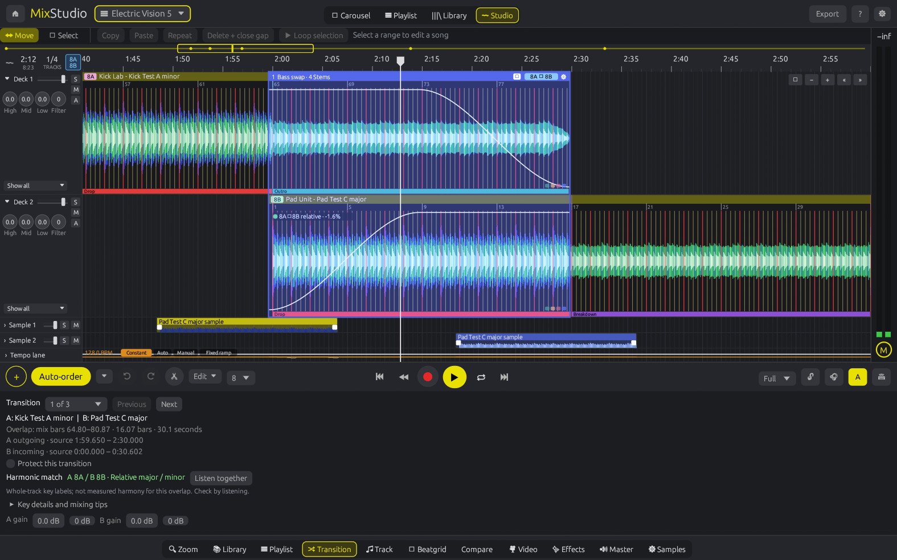
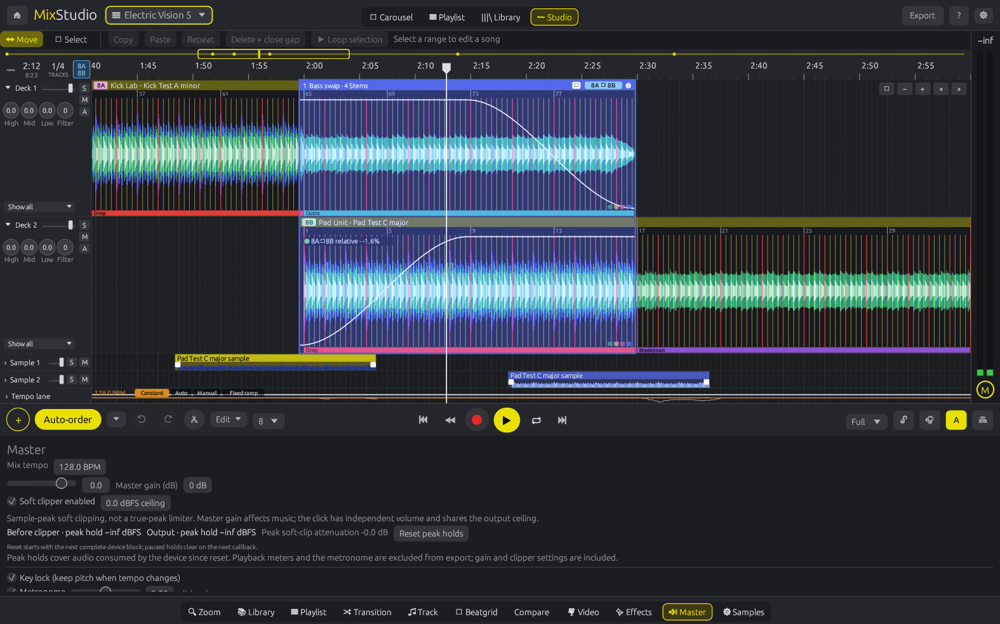

# MixStudio release notes

Detailed notes for each release, newest first. The [changelog](../CHANGELOG.md) has a one-line summary per change, and the [README](../README.md) describes the current version.

## 0.30

**Beatmatch that stays on the kicks.** Two steady tracks at 125 and 126 BPM could drift apart after import even though both were stretched to the mix tempo. The beat tracker sometimes slid smoothly off a steady track's kicks by tens of milliseconds, or settled on the offbeat hi-hats or a constant ~50 ms beside soft kicks. Analysis now searches the kicks on a straight clock directly and adopts it only when it is supported throughout the file and lands clearly more kicks; a final check moves a grid half a beat or by its median kick offset under the same rule. Supported tempo changes are left alone. On a read-only sweep of 301 analysable local tracks, 72 grids changed, all landing more kicks (9,907 → 22,914 beats on the kick); 229 were unchanged.

Cache version 14 refreshes derived analysis. **Saved project grids stay unchanged:** Beatgrid now flags a Dynamic clip whose saved grid differs from the current analysis and offers **Use current analysis**. Reset keeps the downbeat on a whole beat in the clip's previous bar phase. Listen and check bar 1 afterwards.

**One-click Auto-align.** **Transition → Beatmatch → Auto-align B** measures the overlap, applies a consistent offset or tempo-drift correction to the incoming grid as one Undo step, then measures again so you see what remains. Uncertain evidence is never applied. Outro/intro overlaps whose drums do not coincide are measured against the shared mix grid, using A up to 16 bars before and B up to 16 bars after the overlap; a drifting outgoing grid makes the result Uncertain instead of falsely stable. Nudge B by ±1/±10 ms with the buttons or `,` / `.` (Shift for 10 ms).

**A roomier Library with preview.** Library mode gives the browser most of the window while both decks stay visible as drop targets. Press ▶ on any row to hear the file alone at its original tempo, from the first detected drop; click or drag the preview waveform to jump, and press Space to stop. The mix playhead, loop and timeline view are restored, and nothing enters the project or export. Folder rows truncate long names with right-aligned counts, keys show as Camelot chips, Enter adds the selection and Ctrl+A selects every visible file.

Symbols that rendered as "□" (arrows, tab icons, key-change labels) now use glyphs from the bundled fonts, guarded by a test. See the [0.30 beatmatch and Library verification](BEATMATCH-LIBRARY-2026-10-26.md).

## 0.29.1

Library drops onto main decks now align the analysed downbeat to the snapped destination. Aligning the raw file edge could leave two songs with different introductory offsets off the shared beat/bar grid. Following deck imports use the active snapping setting; samples keep their exact visible-edge placement. Drops near timeline zero retain introductory audio by moving the anchor forward by complete snap units.

This placement repair does not replace saved beatgrids or change the audio renderer. The current source-analysis and musical downbeat limitations still apply. See the [beatmatch investigation](BEATMATCH-2026-10-19.md).

## 0.29

**A clearer Library:** actual filenames lead each taller row, with artist/title below and compact BPM, key and duration columns. Resize the Library panel vertically and the folder sidebar horizontally. Search includes filenames; Details reveals folder/genre, and hovering shows the complete path and imported metadata.

Browse indexed music folders and subfolders with track counts. Advanced DJ imports, path remapping and source management live in collapsed sidebar sections. Sorting and filtering retain file-based selections safely while background analysis updates the index.

Drag anywhere in a row onto a deck or sample lane. The marker shows the snapped destination, and main-deck clips align their analysed downbeat (corrected in 0.29.1); sample clips retain the visible start position, including source offsets and resolved beat ratios. Selected files follow the visible list order. **Add last in mix** and double-click use the normal end-of-mix arrangement. Each batch is one undo step; failed files are reported while valid files continue, and a locked/replaced document rejects late imports.

See the [Library workflow and verification](LIBRARY-2026-10-19.md).

## 0.28

**Curved clip fades:** select a song or sample, drag its corner handles to set fade length, then drag the round midpoint vertically to bend the envelope. Double-click the midpoint to restore a linear fade. Old projects keep their linear fades.

**Faster samples:** Alt-drag a selected song section or stem onto Sample 1/2. Copies reference the original audio and retain arranged source cuts, beat ratios and automation. Shift-click samples or Shift-drag empty sample space to select multiple clips, then drag one to move the group with its timing intact. Alt-drag an existing sample to duplicate it.

**Stem volume curves:** separate the source, then open **Track → Edit stem volumes**, or select four-stem view and **A**. Click in a stem row to add a volume point, drag it to adjust volume/time, and right-click a point to remove it. **Reset stem volumes** restores all four envelopes to 100%. These multiply existing stem mutes and transition processing, using the same engine for playback and export. Stem-edited projects prepare the required stems when opened or relinked; export waits until they are available.

See the [editing workflow and verification](CLIP-SAMPLE-STEMS-2026-10-18.md). Analysis and saved beatgrids are unchanged.

## 0.27

**Transition → Harmonic match** explains same, neighboring and relative major/minor Camelot keys. Open **Key details and mixing tips** for musical key names, common source-key matches and practical blend advice; **Listen together** starts the existing processed A/B audition. Unknown keys remain unknown. These are whole-track source labels, not a local harmonic measurement or confidence score. Pitch-following-tempo warnings include split fragments.

The [Beat This! pilot](BEAT-THIS-EVALUATION-2026-10-18.md) tested the official neural model locally on six music files and two authored references. It remains an optional research tool: this release keeps v13 beat analysis and does not bundle an AI runtime/model or replace saved grids. See the [harmony workflow and verification](HARMONY-2026-10-18.md).

## 0.26

Fix a reproduced beatmatch failure where two correctly detected 126-BPM songs fell out of sync because a Dynamic grid followed offbeat percussion during a breakdown, drifting almost half a beat before returning. Analysis can now bridge a large phase excursion using a steady clock supported by attacks throughout the source. Supported tempo motion vetoes this correction, including temporary changes and halftime kick patterns; this remains a heuristic requiring listening.

Beatgrid explains when source analysis used this correction. Cache version 13 refreshes derived analysis. **Saved project grids stay unchanged:** on an uncut source clip, use **Beatgrid → Reset to analysis** to adopt the new result, then listen and check bar 1. See the [phase-continuity investigation and verification](BEATGRID-PHASE-2026-10-18.md).

## 0.25

Adjust **Song gain** in Track or for A/B in Transition; logical split fragments share the setting. Track can measure whole-source sample peak and stereo RMS in the background. RMS includes silence and is not perceived loudness or LUFS.

Open **Master**, or the **M** shortcut beside the output meter, for music gain in dB, soft-clipper bypass/ceiling, and held peaks before/after clipping with peak attenuation. Measurements follow audio consumed by the device. The click keeps independent volume and shares the output ceiling. This is a sample soft clipper, not a true-peak limiter or automatic normalizer. See the [level controls and verification record](LEVELS-2026-10-18.md).

## 0.24

The Transition tab now shows the outgoing and incoming source intervals, including arranged cuts, alongside the overlap’s mix bars and duration. Processed audition adds before/after bars, repeat, and **Monitor A / Both / Monitor B** without restarting the playhead. Project deck mute/solo is temporarily overridden; shared FX tails continue across switches. Export and saved mixer settings stay unchanged.

**Protect this transition** saves its lock and disables that transition’s preset, stem and volume-curve edits. This first version freezes arrangement moves, trims, cuts, reorder and automatic beat-ratio changes while any transition is protected; unlock in Transition to edit placement. Master, FX and other transitions’ presets remain separately editable. See the [workflow and verification record](TRANSITIONS-2026-10-17.md).

## 0.23

Tempo analysis no longer forces every result into 85–175 BPM. It compares rhythmic accents and bass-attack coverage when considering half/double tempo, covering explicit slow pulses, fast pulses and eighth-note percussion. Beatgrid advises checking bar 1 when the selected downbeat lacks a distinct bass accent or there is too little evidence to assess it. These checks are heuristics, not musical certainty.

The [tempo and metre verification report](TEMPO-METER-2026-10-16.md) separates authored rhythm references, a small visually marked waveform pilot and the unlabelled music corpus. Cache version 12 refreshes derived analysis; saved grids and edits remain intact. Use **Beatgrid → Reset to analysis** on an uncut source clip to adopt the result. Listen and check its interpretation before arranging sections.

## 0.22

Beat analysis now rejects unsupported grids from stationary noise, isolated attacks with noise and sustained carrier tones. Gain-safe onset calculations preserve very quiet rhythmic recordings. Beatgrid shows an advisory when source evidence is insufficient or sparse. The [real-file test report](BEAT-ANALYSIS-2026-10-16.md) records the corpus, measured changes and limits; these are not annotated musical accuracy scores.

Analysis cache version 11 refreshes derived results while retaining library tags and saved project grids. For an existing uncut source clip, use **Beatgrid → Reset to analysis** to adopt the new result; review it before section editing. Musical downbeats and half/double tempo still require listening and manual judgement.

## 0.21.2

Key lock now uses Signalsmith Stretch for cleaner vocals and polyphonic music during tempo changes. A buffered audio worker prepares playback ahead of the device callback; transport changes discard stale queued audio and the playhead follows consumed samples. See the [playback verification record](PLAYBACK-2026-10-16.md).

## 0.21

This maintenance release addresses the prioritised renderer, editing and storage findings in the [application audit](AUDIT-2026-10-16.md). See the [fixes and verification record](MAINTENANCE-2026-10-16.md) for scope and remaining limits.

- **Playback:** remove the hidden 64-track key-lock and 16-effect limits, prepare DSP state outside the audio callback, retain unchanged effect history, and clear deleted/replaced effects safely. Seek resets filters and transport history.
- **Timing:** accurate tempo integration and loop boundaries, including tempo-floor crossings; identical rendered output across tested callback partitions. Tiny loops reanchor stretched audio. Effect starts/releases follow sample timing.
- **Editing:** retain full transition envelopes and source-cut smoothing after splitting, keep logical fragments together when changing transition position/length, lanes or ratios, and map phrases through the source grid and arranged occurrences. Layout remains stable on later frames.
- **File safety:** validate projects/recovery before activation or replacement, reject damaged sources where integrity can be checked, retain library metadata under unreadable subfolders, verify cached model hashes, preserve complete FX export tails, and isolate MP3 scratch files.

Compare dry audition includes every split fragment. Automatic beatmatch measurement/correction and two-anchor correction require unsplit clips; correct source grids before splitting. Existing split projects saved before this release lack logical fragment identity and are not automatically regrouped. A layout that oscillates between automatic half/double ratios keeps only the conflicting ratios explicit; Undo restores the previous layout.

## 0.20

- **More precise beat/BPM analysis:** fit steady tempo from supported sample-level attacks, preserve fractional BPM, interpolate missing kicks between supported attacks, and retain rhythm in side-dominant stereo without letting a sustained stereo pad hide centred kicks. Sparse attacks cannot qualify as a precise steady fit. Dynamic remains the default; deliberate ramps keep variable timing.
- **Existing libraries refresh:** detector version 10 invalidates old derived library BPM/key values while retaining tags. Cancelled analysis jobs cannot overwrite a newer scan.
- **Editing and source safety:** fix duplicate automation points and drag crashes, preserve explicit beat ratios when splitting, resolve Auto-tempo reorder against the requested order, handle Unicode keys safely, and keep dropped audio in unique persistent source paths.

Existing project grids and manual edits stay saved as they were. Reopen a project to load the new analysis, then use **Beatgrid → Reset to analysis** on an uncut source clip to adopt it. Correct the grid before making section edits. A displayed decimal is precision of representation, not a confidence guarantee.

Read the [full audit and prioritised open issues](AUDIT-2026-10-16.md). The controlled test results are not a guarantee of perfect beat counts or musical downbeats on arbitrary recordings. The renderer timing, long-set key-lock and split-transition findings were subsequently addressed in 0.21; analysis confidence and broader music validation remain ongoing work.

## 0.19

- **Autosave and recovery:** check for changes once a second and keep a separate recovery snapshot approximately every 15 seconds while editing. Disk writes run on a background worker. Startup offers recoverable copies; **Restore copy** opens one without overwriting the original and requires **Save as…**.
- **Safer manual saves:** write a sibling temporary file, sync it, then replace the project. Keep the previous saved version beside it as `<project>.bak`. Failed writes preserve the previous file.
- **Protected project changes and normal close:** before New/Open replaces unsaved work, wait for a confirmed recovery write. Normal close also waits for confirmation; failure leaves the current project/app open. Old file dialogs, analysis results and edit drags cannot mutate the next document.
- **Relink moved audio:** use the project menu's **Locate missing audio…**, choose the same recording, review it and confirm. Update every split/arranged occurrence while keeping timing, beatgrids, sections, cues and phrase edits. Replacements shorter than source material used by the project are rejected; relinking has one Undo step.

Use the project-name menu for **Recover unsaved projects…**, **Locate missing audio…** and recovery status/errors. **Ctrl+S** saves and **Ctrl+Shift+S** opens Save as. A `*` beside the project name indicates unsaved changes (updated on the next one-second check).

Recovery files live in the app's configuration folder under `recovery` (`~/.config/mixstudio/recovery` on Linux). Keep them for later or explicitly discard an individual copy. Successful manual saving removes the active recovery and any copy restored into that document. To use a manual `.bak` backup, copy it to a `.json` filename and open that copy. Recovery snapshots are limited to 64 MiB; oversized or invalid snapshots fail visibly rather than replace a usable copy. Forced termination can lose changes made since the latest completed autosave.

## 0.18

- **Richer rhythm evidence:** combine bass attacks with broadband percussion onsets. Sparse, sustained or conflicting evidence stays uncertain. The comparison view marks weak sampled beats in yellow and supported pairs in green/cyan; unmarked beats have not been measured.
- **Compare view:** outgoing and incoming source waveforms share a mix-beat axis, with 2–32 beat zoom, navigation, separate **Listen A / B / both** buttons and a preview metronome. Dry audition bypasses transition curves, EQ, FX and stem automation and stops at the visible range's end. It restores the exact suspended loop and stays out of project/export data.
- **Two manual anchors:** assign two incoming source attacks to known mix beats, inspect the proposed BPM and hear/see the proposed grid before applying it. One Undo restores the old grid. The correction fits phase and a uniform tempo error while preserving the existing grid's local shape.

### Correct an overlap with two anchors

1. Open **Compare** (or **Beatgrid → Compare waveforms + anchors**) and select the transition. **Measure overlap** adds evidence markers; uncertain evidence does not prevent manual inspection.
2. Choose **Set A**, set its **Target mix beat**, then click the corresponding attack in the yellow incoming waveform. Beat numbers in this view start at 1. Fine-adjust the source time below the waveforms if needed.
3. Navigate later in the overlap, choose **Set B**, and assign a second clear attack to its target beat. Separate A and B by at least four beats; a longer interval makes drift easier to judge.
4. Toggle **Preview proposed grid**, listen to A/B/both with the metronome, then choose **Apply both anchors** when satisfied. Until Apply, saved projects and exports retain the original grid.

Anchors correct the incoming source clip and currently require unlocked editing, an uncut clip and a 1:1 beat ratio. They do not infer musical phrasing or remove arbitrary local timing errors. Correct the source grid before arranging sections; use single/following-beat edits for remaining local errors.

## 0.17

- **Dedicated Beatgrid tab:** source analysis, active grid BPM, mix BPM and beat ratio shown together. Whole-grid, single-beat and following-beat modes stay visible, with ±1/±10 ms correction, previous/next beat and zoom to target.
- **Assisted beatmatch:** choose a transition and **Measure overlap**. A background bass-attack check reports signed offset, drift, scatter and usable beat count. Consistent evidence enables an explicit incoming-grid correction with one Undo; drifting or uncertain evidence stays advisory.
- **Safer edits:** fractional grid anchors preserve neighbouring beat positions during single-beat edits, stale measurements cannot apply after timing changes, and arranged sections are protected from grid changes.
- **Clearer Track tab:** reachable clip properties and stem controls; timing tools live in Beatgrid. The playback buffer fix from 0.16.1 is retained.

The check compares bass attacks, not musical phrasing. Silence, sustained bass and unclear drums can leave too little evidence; listen after every correction. Single/following editing and overlap measurements currently require a 1:1 beat ratio. Correct the source grid before arranging sections.

## 0.16

- **Arrange sections inside a song:** select a beat- or bar-snapped range, repeat it, copy/paste it at the playhead, or delete it and close the gap.
- **Ripple editing:** later songs keep their transition overlaps when a song becomes longer or shorter. Later samples, effect blocks and manual tempo points move with the edit.
- **Audition the selection:** loop the marked section, then return to normal clip movement with **Move**. Each section edit has one Undo step.
- **Timing fixes:** fine grid offsets stay precise, edited sections keep their original source beatgrid, and splice fades/reset handling work in the shared playback/export renderer. **Dynamic** stays the default; experimental **Flex** is selected manually.

The clipboard in this first version rearranges sections **within the same source song**. It does not copy audio between different songs. Original audio files are never rewritten.

## Earlier releases (0.11–0.17)

### Scratch effect (v0.11)
Add a **Scratch** block in the effects grid on a deck or sample lane. It drives the turntable position under the block
(smooth varispeed, a falling line plays in reverse) and loops when the block is longer than the pattern.
Presets: Baby scratch, Downer, Transformer, Reverse, Chirp. **✎ Pattern editor…** opens the syntax editor:
`A`–`E` position targets within the beat (A = start, E = end), `.` next beat, `r` release (mute), `>` open, `-` hold;
with live graph, Easing, Preview, Save as preset and Delete. Applies in playback and export.

### Phrase detection (v0.12)
Analysis finds phrase boundaries on the 8/16/32-bar grid from energy, spectrum (3 bands) and novelty, and labels
them **Intro / Build / Drop / Breakdown / Outro** (heuristic). Coloured phrase strips and markers sit on every clip:
click a phrase to cycle its label, right-click to choose one or reset to the detection (edits are saved in the project).
Clips snap to other clips' phrase boundaries. Auto-order and *Overlap outros with intros* start the next track's
intro on the previous track's outro. (Analysis cache v9: stale cached analysis is regenerated.)

### Import from other DJ software (v0.13)
The Library tab has a sidebar with your MixStudio folders and **Other DJ software**: *Find libraries* looks in the
usual places (home, Documents, Music, mounted drives incl. Windows/macOS user folders), or *Browse…* / paste a file:
Rekordbox XML (File ▸ Export Collection in xml format), Traktor `collection.nml`, Serato `_Serato_/database V2`
(+ crates), Engine DJ `Engine Library/Database2/m.db`, iTunes / Music `Library.xml`. Playlists and folders appear as a
tree; the table shows the other app's BPM and key (e.g. *Key (Rekordbox)*) next to MixStudio's. Cue points
(Rekordbox, Traktor) become orange markers on the clip when the track is added to the mix. **Path remapping** rewrites
prefixes such as `C:\Users\Mike\Music` → `/mnt/windows/Users/Mike/Music`. Imports are strictly read-only (Engine's
database is read from a temporary copy). Not yet: Serato / Engine cue points (stored in file tags / compressed blobs).

### Big tempo jumps (v0.14)
Each transition has a **Beat ratio** (transition panel): *Auto*, 1:1, 1:2, 2:1, 2:3, 3:2. With 1:2 one beat of the
incoming track spans two mix beats, so a 70 BPM track locks onto a 140 BPM mix (kicks within a millisecond in the
selftest); 2:3 maps two track beats onto three mix beats. *Auto* (default) switches to half / double time only when it
is clearly closer to the tempo it joins, which also fixes Auto tempo gliding 140 → 70 BPM between such tracks.

### Beatgrids (v0.15)
- **Grid mode per clip** (Beatgrid tab): *Fixed* (straight grid at the average BPM), *Dynamic* (the analysed beat map),
  *Flex* (piecewise grid that follows tempo jumps and ramps, found by change-point detection on the tempo curve),
  *Imported* (Rekordbox/Traktor grid, when the track came from an import) and *Manual* (set automatically when you
  edit the grid). Split clips keep their own mode.
- **Stabilize tempo** (Track tab): in Auto tempo a stabilized clip plays flat at its average tempo. Typical use: split
  at the intro and outro, stabilize just those clips so they mix on a straight grid; boundaries stay seamless.
- **Tempo lane**: per clip the average BPM (orange) and the local tempo (grey); zoom in to see drift % labels.
- **Downbeats**: bar lines red, beats yellow, bars stay visible zoomed out; *Set downbeat* recolours them.

### Section editing and timing corrections (v0.16)
- Ordered source ranges keep repeated and deleted sections non-destructive; the waveform and audio renderer use the same arrangement mapping.
- Source automation follows copied/deleted ranges. Manual tempo interpolation outside the edit is preserved when later points ripple.
- Short splice fades and section-aware WSOLA pre-roll avoid carrying audio from the previous section across a cut. Beat Slice evaluates its source endpoints inside the current section.
- Selection clears when its song, grid or timeline placement changes, preventing actions on an outdated range. Edited trim gestures use the drag-start arrangement so dragging back restores material within the same gesture.
- Dynamic/Flex/Imported grid evaluation preserves fine fractional offsets. Returning to an analysed grid restores its compatible source BPM; Flex is never enabled automatically.

### Beatgrid controls and assisted alignment (v0.17)
The **Beatgrid** tab separates source-grid correction from clip placement. Fine corrections use source seconds; positive values move grid markers later in the source, making the corresponding audio play earlier against the mix grid. The selected target is the nearest visible clip beat to the playhead. **Beat + following** stretches from the marker one bar before the target.

**Measure overlap** compares paired bass attacks on a background thread. Positive offset means incoming attacks are late. The report distinguishes consistent offset, drift and inconsistent attacks. Only sufficiently supported constant offsets enable **Correct incoming grid**. The check rejects sparse attacks and limited coverage; it does not infer the musical downbeat or rewrite analysis. Changed timing or audio invalidates the result, and each applied correction has one Undo step.
